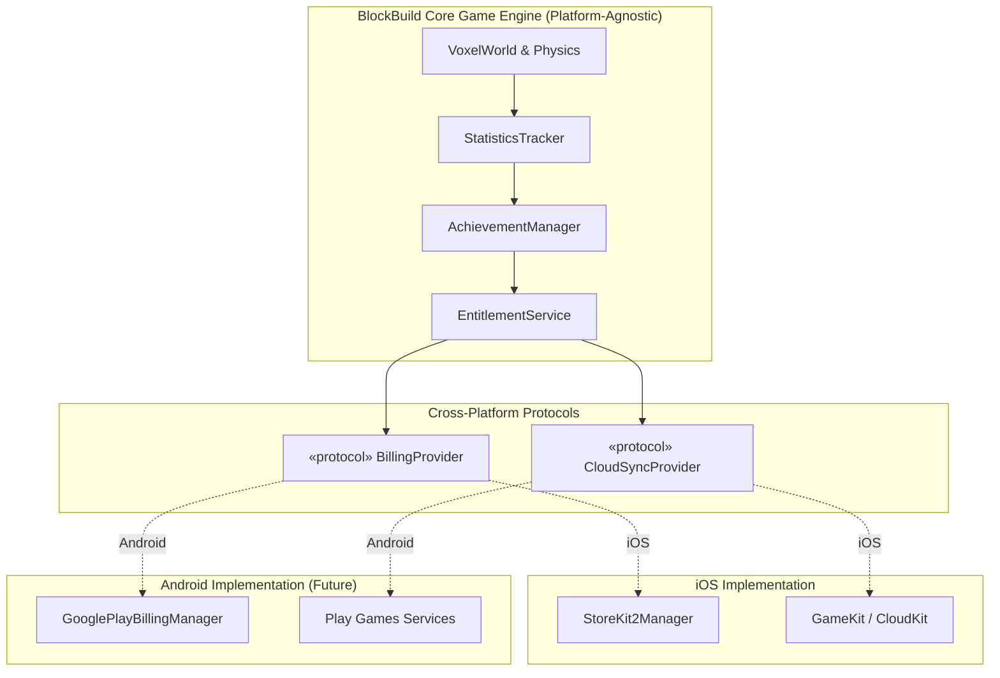
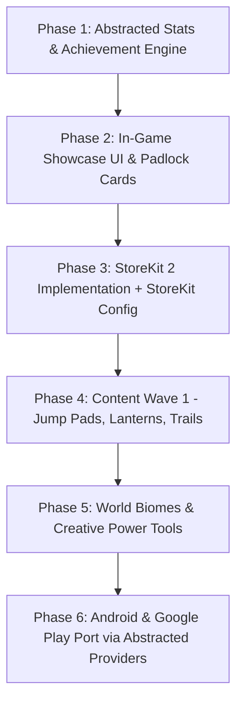

# BlockBuild — Monetization, Unlockable Features & Cross-Platform Roadmap
*(iOS App Store & Google Play Store)*

---

## 1. Executive Summary & Cross-Platform Economics

### The Objective
Recoup baseline operational costs for publishing and maintaining **BlockBuild**:
- **Apple App Store**: Apple Developer Program annual fee (**$99/year**, recurring).
- **Google Play Store**: Google Play Console registration (**$25 one-time**, lifetime).
- **Optional Infrastructure**: Future matchmaking relays, cloud world backups, or website hosting (~$5–$15/month).

### Comparative Store Economics

```
+-----------------------------------------------------------------------------------------------+
| Metric                      | Apple App Store                  | Google Play Store            |
+-----------------------------------------------------------------------------------------------+
| Developer Fee               | $99 / year (recurring)           | $25 one-time (lifetime)      |
| Dev Cut (Under $1M)         | 85% (Small Business Program)     | 85% (15% Tier Tier-1 Tier)   |
| In-App Purchase Framework   | StoreKit 2 (Swift Concurrency)   | Google Play Billing Library  |
| Achievements & Cloud Saves  | GameKit / iCloud Keychain        | Google Play Games Services   |
| Break-Even Target           | ~59 sales/yr of $1.99 packs      | ~15 total sales of $1.99     |
+-----------------------------------------------------------------------------------------------+
```

Because Google Play requires only a single $25 lifetime fee, **every sale on Android directly subsidizes the recurring iOS annual fee and server costs**.

### The Philosophy: "Play to Unlock OR Pay to Support"
Modern mobile gamers are fatigued by aggressive paywalls, energy timers, forced interstitial ads, and predatory gacha mechanics. As an indie voxel sandbox, BlockBuild thrives on player creativity, immersion, and community enthusiasm.

Our strategy is **Hybrid Dual-Unlock**:
1. **Earnable by Everyone**: Every gameplay-enhancing or cosmetic feature can be unlocked for **free** through engaging in-game achievements, exploration milestones, and creative challenges.
2. **Instant Unlock & Dev Support**: Players who have busy schedules, or who simply love the game and want to financially support the developer, can instantly unlock individual items or bundles via small In-App Purchases (IAP) ranging from **$0.99 to $4.99**.
3. **Pure Goodwill / Indie Tip Jar**: Voluntary tip items ("Coffee for the Dev" at $1.99, "Builder's Lunch" at $4.99) with cosmetic perks like a shimmering golden nameplate or crown.

---

## 2. Core Feature Catalog (Dual-Unlock Candidate Matrix)

Features are evaluated by **Fun Factor**, **Implementation Complexity**, and **Dual-Unlock Mapping**.

```
+-------------------------------------------------------------------------------------------------------+
| Feature                      | Type       | Achievement Unlock Path        | IAP Price | Complexity   |
+-------------------------------------------------------------------------------------------------------+
| Neon Cyber Skin Pack (4)     | Cosmetic   | Place 5,000 blocks in Cave/Dark| $1.99     | Low          |
| Legendary Mythic Skins (3)   | Cosmetic   | Walk 50km + Find Cave Depth    | $1.99     | Low          |
| Particle Footstep Trails     | Cosmetic   | Fall 1,000 blocks into Void    | $1.49     | Medium       |
| Light Blocks & Lanterns      | Block Pack | Mine 500 stone & 200 wood      | $1.99     | Medium       |
| Bounce Pad / Trampoline Block| Block Pack | Jump 1,000 times               | $0.99     | Low-Med      |
| Firework Launcher Block      | Block Pack | Build to y=50 height           | $1.49     | Medium       |
| Volcanic Nether World Type   | World Gen  | Create 5 different worlds      | $2.99     | Medium       |
| Low-Gravity Space World      | World Gen  | Take 10 photos in Sky Islands  | $2.99     | Medium       |
| Blueprint / Structure Wand   | Tool (QoL) | Complete 10 Master Builds      | $3.99     | High         |
| Cinematic Golden-Hour Camera | Tool (QoL) | Capture 25 in-game photos      | $1.49     | Low-Med      |
| Founder's Pass (All-Inclusive)| Supporter  | N/A (Direct Dev Support)       | $9.99     | Low          |
+-------------------------------------------------------------------------------------------------------+
```

---

### Detailed Feature Categories

### Category A: Visual & Avatar Customization (High Appeal, Low Friction)
Cosmetics never impact game balance, making them universally beloved and guilt-free monetization candidates.

1. **Particle Footstep Trails & Auras**:
   - *Effects*: Sparkles, fiery embers, autumn leaves, water ripples, neon cyber runes emitting behind player feet.
   - *Achievement*: "Void Walker" (Survive or fly through the void for 2 cumulative minutes in Sky Islands) or "Marathoner" (Travel 10,000 voxel meters).
   - *IAP*: $1.49 for the Trail Master Bundle.

2. **Special Themed Skin Packs**:
   - BlockBuild already has 14 fantastic skins (Steve, Alex, Knight, Ninja, Wizard, Cyborg, Astronaut, etc.).
   - *Expansion*: "Elementals & Guardians" (Magma Golem, Ice Wraith, Forest Dryad, Golden Builder).
   - *Achievement*: Complete biome exploration or world survival milestones.
   - *IAP*: $1.99.

3. **Golden Builder Trophy / Crown**:
   - A shiny crown or golden pickaxe accessory rendering on the player avatar.
   - *Achievement*: "Master Architect" (Place 10,000 total blocks across all worlds).
   - *IAP*: Unlocked automatically with any Tip Jar purchase!

---

### Category B: Novelty & Functional Special Blocks (The Most Fun Category)
Adding fun, interactive block mechanics gives players exciting toys to experiment with in their creations.

1. **Light-Emitting Lanterns / Glow Blocks**:
   - *Behavior*: Blocks with localized point lights or emissive materials, illuminating dark cave caverns and night builds.
   - *Achievement*: "Spelunker" (Explore 10 chunks deep underground in Cave Lands).
   - *IAP*: $1.99.

2. **Jump / Bounce Pads**:
   - *Behavior*: Stepping on this block launches the player or blocks 15 blocks into the air with a boing sound and haptic pulse.
   - *Achievement*: "High Flyer" (Perform 500 jumps).
   - *IAP*: $0.99.

3. **Firework / Confetti Launcher**:
   - *Behavior*: Tapping or stepping on it shoots voxel fireworks into the sky with customizable colors.
   - *Achievement*: "Celebration Time" (Take 15 world screenshots using the new photo mode).
   - *IAP*: $1.49.

4. **Portal / Teleporter Blocks**:
   - *Behavior*: Place two linked portal blocks to instantly teleport between your castle peak and underground bunker.
   - *Achievement*: "Warp Master" (Travel over 5,000 blocks in a single world).
   - *IAP*: $2.49.

---

### Category C: Exotic World Generation Biomes
Expanding beyond the existing 8 world types:

1. **Volcanic Caldera / Nether Core**:
   - Jagged obsidian peaks, glowing lava flows (using emissive animated water shader), ash atmosphere.
   - *Achievement*: "Firestarter" (Break 1,000 stone blocks in Cave Lands).
   - *IAP*: $2.99.

2. **Asteroid Belt / Space Station (Low Gravity)**:
   - Floating asteroid chunks in deep space with starry skybox and altered physics (longer floaty jumps).
   - *Achievement*: "Starbound" (Build a structure exceeding y=60 in Amplified Peaks).
   - *IAP*: $2.99.

3. **Candyland / Pixel Pop**:
   - Neon pastel terrain, peppermint bark trees, jelly water, cotton candy clouds.
   - *Achievement*: "Sugar Rush" (Create 10 different saved worlds).
   - *IAP*: $2.99.

---

### Category D: Creative Power Tools (Quality-of-Life)

1. **Blueprint / Structure Stamp Wand**:
   - Select a 10x10x10 box of blocks, copy it, and stamp it elsewhere or export it.
   - *Achievement*: "City Planner" (Place 25,000 blocks).
   - *IAP*: $3.99.

2. **Cinematic Photo & Lighting Studio**:
   - Sliders for custom time-of-day (Sunset, Midnight, Eclipse), depth-of-field focus blur, and retro pixel-art camera filters.
   - *Achievement*: "Shutterbug" (Save 20 clean photos to the device gallery).
   - *IAP*: $1.49.

---

## 3. Cross-Platform Architecture: Abstracted Entitlements & Billing

To ensure we can release on iOS and easily port to Android without re-architecting, **platform-specific APIs must never be hard-coded into the game engine or progression logic**.



### 3.1 The Abstracted `BillingProvider` Protocol
Both Apple StoreKit 2 and Google Play Billing use identical product IDs and purchase flows (load products, purchase, query active entitlements, restore purchases).

```swift
/// Platform-agnostic billing protocol
public protocol BillingProvider: AnyObject {
    /// Loads products from either StoreKit 2 or Google Play Billing
    func fetchProducts(productIDs: Set<String>) async throws -> [ShopProduct]
    
    /// Executes purchase with native platform sheet (Apple Pay / Google Pay)
    func purchase(productID: String) async throws -> PurchaseResult
    
    /// Queries whether the user currently owns the given non-consumable
    func isPurchased(productID: String) -> Bool
    
    /// Restores previously completed transactions
    func restorePurchases() async throws
}
```

### 3.2 Product ID Consistency Across Stores
Product IDs are kept identical across both platforms:
- `com.blockbuild.blocks.jumppad`
- `com.blockbuild.blocks.lanterns`
- `com.blockbuild.skin.neon`
- `com.blockbuild.trail.embers`
- `com.blockbuild.world.volcanic`
- `com.blockbuild.tool.blueprint`
- `com.blockbuild.supporter.coffee`
- `com.blockbuild.supporter.founder`

---

## 4. Android Porting Strategy & Technical Pathways

BlockBuild currently uses **SwiftUI** for UI and **SceneKit** for 3D voxel rendering on iOS. When preparing for Android, there are three primary strategies:

```
+------------------------------------------------------------------------------------------------------+
| Strategy                    | Pros                                  | Cons                           |
+------------------------------------------------------------------------------------------------------+
| Path A: Skip.tools          | Keeps 100% Swift codebase; transpiles | SceneKit must be bridged to    |
| (Swift -> Kotlin/Android)   | SwiftUI to Jetpack Compose            | OpenGL ES or Filament          |
+------------------------------------------------------------------------------------------------------+
| Path B: C++ Core Engine     | Maximum performance; share 100% voxel | Initial refactoring of chunk   |
| (Voxel/Mesh in C++)         | and terrain logic across iOS/Android  | generation from Swift to C++   |
+------------------------------------------------------------------------------------------------------+
| Path C: Lightweight Voxel   | Multi-platform out-of-the-box (iOS,   | Full engine migration needed   |
| Port (e.g. Godot / Raylib)  | Android, PC, macOS, WebGL)            |                                |
+------------------------------------------------------------------------------------------------------+
```

### Recommended Strategy: "Abstract Today, Port Seamlessly Tomorrow"
1. **Keep Core Logic Clean**: Keep `VoxelWorld` chunk generation, coordinate math, block definitions, statistics, achievements, and entitlements strictly decoupled from `SceneKit` and `StoreKit`.
2. **Build for iOS First**: Complete and polish the game with StoreKit 2 and SwiftUI.
3. **Android Port Phase**: When ready for Google Play, the entire business logic, achievement catalog, and monetization scheme will transfer 1:1.

---

## 5. Achievement System & Gameplay Milestones

To make achievements feel exciting rather than grindy, we categorize them into **fun themes**:

### Thematic Achievement Tracks
1. **The Grand Architect**:
   - *Milestone 1*: Place 100 blocks ("Apprentice Builder") -> Unlocks: Stone Texture Variation.
   - *Milestone 2*: Place 1,000 blocks ("Master Mason") -> Unlocks: Jump Pad Block.
   - *Milestone 3*: Place 10,000 blocks ("Monument Builder") -> Unlocks: Lanterns & Glow Blocks.
2. **The Intrepid Explorer**:
   - *Milestone 1*: Walk 5,000 blocks ("Trailblazer") -> Unlocks: Dirt Trail FX.
   - *Milestone 2*: Descend below y=5 in Cave Lands ("Underground Legend") -> Unlocks: Miner Helmet / Glow Skin.
   - *Milestone 3*: Fly over 10 chunks in Sky Islands without falling ("Icarus") -> Unlocks: Feather Trail FX.
3. **The World Crafter**:
   - *Milestone 1*: Create a world of every type ("Cosmic Creator") -> Unlocks: Volcanic World Type.
   - *Milestone 2*: Save 10 worlds with custom names ("Librarian") -> Unlocks: Custom Skybox Palette.
4. **The Master Photographer**:
   - *Milestone 1*: Take your first clean world photo ("Say Cheese!") -> Unlocks: Camera Shutter Haptics.
   - *Milestone 2*: Take 20 photos across 3 different worlds ("World Geographer") -> Unlocks: Cinematic Lighting & Filter Controls.

---

## 6. Phased Implementation Roadmap



### Phase 1: Gameplay Stats & Achievement Engine (Est. 1-2 days)
- [ ] Create `StatKey` tracking system (`blocksPlaced`, `blocksBroken`, `metersWalked`, `photosSaved`, `worldsCreated`).
- [ ] Hook into `placeSelectedBlock()`, `breakTargetedBlock()`, `stepPhysics()`, and `PhotoAlbumSaver`.
- [ ] Implement platform-agnostic `AchievementManager` with persistent storage.
- [ ] Build in-game animated toast notification ("Achievement Unlocked: Master Mason!").

### Phase 2: In-Game Showcase UI & Previews (Est. 1 day)
- [ ] Create `AchievementsSheet.swift` showing progress bars, completed badges, and rewards.
- [ ] In the Inventory and Skin selector, show locked items with a clean padlock badge and a dual action:
  - *"Unlock via Achievement: Walk 5,000m (72% complete)"*
  - *"Or Unlock Instantly for $0.99"*
- [ ] Add celebration particle confetti effect when an unlock occurs.

### Phase 3: StoreKit 2 Integration & Testing File (Est. 1-2 days)
- [ ] Implement `BillingProvider` protocol with `StoreKit2BillingProvider`.
- [ ] Create `BlockBuild.storekit` in Xcode with initial product IDs ($0.99 - $9.99).
- [ ] Create `ShopSheet.swift` displaying featured packs, tip jar, and restore button.
- [ ] Test purchase flow using Xcode StoreKit Transaction Manager.

### Phase 4: Initial Content Drop (Est. 2-3 days)
- [ ] Add Jump Pad block (`.jumpPad`) with vertical launch physics impulse.
- [ ] Add Lantern / Glow block with SceneKit emissive lighting.
- [ ] Add 2 Particle Trail effects (Sparkles, Embers).
- [ ] Add "Dev Tip Jar" with Golden Crown cosmetic.

### Phase 5: World Expansions & Advanced Tools (Future iOS Release)
- [ ] Volcanic / Nether world generation algorithm.
- [ ] Blueprint copy-paste tool.
- [ ] Extended cloud world synchronization.

### Phase 6: Android & Google Play Release (Future Port)
- [ ] Register Google Play Console developer account ($25 one-time fee).
- [ ] Implement `GooglePlayBillingProvider` matching the existing `BillingProvider` interface.
- [ ] Configure in-app products on Google Play Console using identical Product IDs.
- [ ] Connect Google Play Games Services for cross-device cloud achievements.

---

## 7. Git Branching & Release Isolation Strategy

To ensure that core gameplay development on `main` is never blocked or destabilized by ongoing monetization work, all billing and in-app purchase code will be developed in strict isolation on a dedicated branch.

```
 main (Always stable, playable, releasable)
   │
   ├── [Regular gameplay commits: physics, world gen, controls] ─────────┐ (periodic sync)
   │                                                                     │
   └── git checkout -b feature/in-app-purchases                          v
         │
         ├── Commit: Stats & Achievement tracking engine
         ├── Commit: StoreKit 2 & BillingProvider abstraction
         ├── Commit: BlockBuild.storekit local testing configuration
         ├── Commit: Shop & Unlock sheets
         │
         └── [Comprehensive Offline & Sandbox Testing]
               │
               v (Only after 100% verification)
         Merge back into main via Pull Request / Fast-Forward
```

### 7.1 Branch Management Protocol
1. **Branch Name**: `feature/in-app-purchases`
2. **Untouched `main`**: The `main` branch continues to build and run without any dependency on StoreKit, App Store credentials, or monetization logic. You can ship updates or bugfixes to `main` at any time.
3. **Downstream Syncing**: As gameplay improvements or bug fixes land on `main`, periodically merge or rebase `main` into `feature/in-app-purchases`:
   ```bash
   git checkout feature/in-app-purchases
   git merge main
   ```
4. **Pre-Merge Verification Checklist**:
   Before merging `feature/in-app-purchases` into `main`, the following must pass:
   - [ ] Offline resilience: App launches and runs normally with airplane mode enabled (no crashes or infinite spinners when querying store).
   - [ ] Achievement fallback: Features can be unlocked purely via gameplay achievements without making any network calls.
   - [ ] Local StoreKit tests: Purchases, restores, and refunds pass cleanly in Xcode's StoreKit Transaction Manager.
   - [ ] Restore Purchases: Tapping "Restore Purchases" restores previous entitlements seamlessly.
   - [ ] No regression in frame rate (SceneKit 60 FPS maintained during background billing checks).

---

## 8. Financial Projections & Recouping Costs

To break even on Apple's **$99 / year** and Google's **$25 one-time** fee:
- **Year 1 Target (Total $124)**:
  - At **$0.99** (~$0.84 net): **~148 unlocks across both iOS and Android**.
  - At **$1.99** (~$1.70 net): **~73 unlocks total (~6/month across both platforms)**.
  - At **$9.99** Founder Pass (~$8.50 net): **~15 total supporters across the entire year**.
- **Year 2+ Target (Just $99/year for Apple)**:
  - Android becomes 100% net profit / surplus because there is no recurring annual fee on Google Play.

